  

<h1 align="center">Navis</h1>

  <b>The Operating System for Human–Model Collaboration</b> 
  Persistent collaboration that compounds toward deliverables.

  
  

  <a href="./README.md">English</a> · <a href="./README-ZH.md">中文</a>

---

## Overview

Navis is a persistent collaboration framework built around deliverables.

It is designed for work that requires Human and Agent collaboration over time and ultimately produces a concrete outcome — from software development and market research to product design and legal documents.

Most AI collaboration today is centered around **Agents / Sessions**. When a Session ends, project context, experience, and outputs are easily fragmented.

Navis shifts the center of collaboration to the **Project**:

> **The Project persists. The Agent is the temporary execution unit.**

Agents enter a Project to work, then leave their results and experience behind. Agents can be replaced and Sessions can end, but the Project continues.

## Core

* **Persistent Project** — The Project carries its goals, state, knowledge, experience, and artifacts forward over time.
* **Accumulating Context** — Every collaboration adds knowledge and experience, allowing the Project to increasingly understand its own history, goals, and ways of working.
* **Human × Agent** — Humans provide direction and judgment; Agents execute and explore. Both contribute to the same Project.
* **Project Ecosystem** — Artifacts, knowledge, experience, and ways of working accumulate and reinforce one another, gradually forming an ecosystem unique to the Project.
* **Deliverable-driven** — Everything ultimately serves one purpose: continuously producing useful, deliverable outcomes.

## Design Principles

* **Project as the Subject** — Project continuity does not depend on any single Agent or Session.
* **Experience Compounds** — Past work becomes the foundation for future work.
* **Human × Agent Collaboration** — Humans and Agents work within the same Project rather than operating as isolated participants.
* **Deliverables First** — Collaboration ultimately exists to produce concrete, usable outcomes.

## Current Status

The non-UI local runtime is implemented: persistent projects, separate human/agent permissions, CLI/Bridge capture and synchronization, review and delivery commands, and candidate-only model assistance. Docker Compose manages one project with separate API and PostgreSQL containers, persistent database storage and dependency-aware API startup. Model assistance runs within the API, while CLI/Bridge runs on the client machine.

Native client support targets Windows, macOS and Linux. Local submission accepts Windows implementation review and portable regression tests; native Windows CI is still required before claiming a tested cross-platform release. An optional Navis skill guides coding Agents through the installed CLI. The UI and public/hosted deployment remain outside this local profile. See [architecture](docs/architecture.md), [readiness gates](docs/foundation-readiness.md) and [setup and usage](docs/development.md).

Contributions, Issues, and Discussions are welcome.

## License

Free for non-commercial use.

Commercial use requires a separate license — see [LICENSE](./LICENSE).
